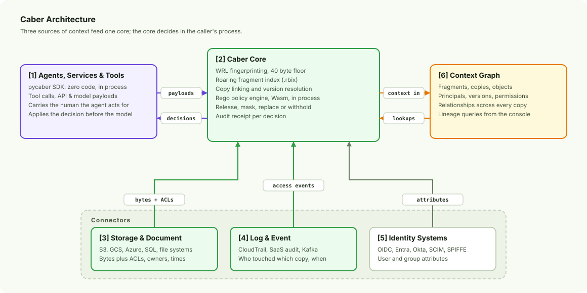

<p align="center">
  <a href="https://caber.com">
    <picture>
      <source media="(prefers-color-scheme: dark)" srcset="https://raw.githubusercontent.com/Caber-Systems/.github/main/images/caber-logo-dark-mode.svg">
      
    </picture>
  </a>
</p>

<h1 align="center">Active Data Use Control for Agentic AI</h1>
<p align="center"><i>Freshness, provenance, and policy, checked down to the sentence before agents see it.</i></p>

<p align="center">
  <a href="https://caber.com">Website</a> ·
  <a href="https://docs.caber.com">Docs</a> ·
  <a href="https://github.com/Caber-Systems/examples">Examples</a>
</p>

## The Problem

AI agents turn longstanding problems with stale and overshared enterprise data into recurring cleanup work for engineers.  

Enterprise users copy and paste text across files, messages, repositories, and tickets. Each copy can have a different owner, access control list (ACL), timestamp, and revision history. MCP, RAG indexes, and tools typically return a single copy with at most that source's metadata. The evidence that a passage is fresh or permissible to use may be attached to another source, if at all.

Agents using service accounts with broad permissions compound the problem. Even with access scoped to the user, agents may find and retrieve protected data fragments from a less restricted copy.

Automation to find duplicate fragments in large enterprise corpora is lacking, while data loss prevention tools perform poorly for text like trade secrets, deprecated code, or other data that is difficult to characterize by its content alone.

***

## Technical Approach

To assess freshness and permissible use, a system needs to connect each retrieved fragment to its known occurrences and use their source metadata before passing the fragment to the model. To trace downstream use, it also needs to record which fragments reached the model and what evidence links them to its output.

Caber implements this in five stages.

1. **Identify fragments.** Split files, messages, and payloads into overlapping, content-defined fragments roughly a sentence long, with a 40-byte minimum. Fold ASCII case and collapse whitespace runs before fingerprinting so identical normalized bytes produce the same fingerprint.
2. **Link occurrences.** Match fingerprints across documents, API payloads, and agent tool calls, independent of file identity, location, or labels. Report byte ranges for matching spans. Overlapping fragments preserve matches outside edited regions. Matching uses normalized bytes without embeddings, so a paraphrase with no surviving 40-byte run cannot match.
3. **Attach source context.** Record each occurrence’s source owner, ACL, timestamps, and version in the context graph. Cluster documents by shared fragments and order each cluster into a version history (beta).
4. **Enforce policy.** At retrieval time, evaluate compiled Rego in process using the fragment’s context, the user the agent acts for, and the request purpose. Release, mask, replace, or withhold the fragment before it reaches the model.
5. **Trace use.** The SDK ties observed fragments to instrumented application, tool, and API calls and their identities, and audits each policy decision. Caber links delivered fragments to model outputs with TAINTS relationships (beta) and records the evidence for each link, whether the output cites the source, reproduces a fragment, or the source was present in model context. The links exclude withheld fragments and also cover data the same user read earlier in the trace or session.

***

## Architecture

<p align="center">
  <picture>
    <source media="(prefers-color-scheme: dark)" srcset="https://raw.githubusercontent.com/Caber-Systems/.github/main/profile/caber-architecture-dark.svg">
    
  </picture>
</p>

*Figure 1: Caber architecture. Three sources of context (instrumented callers, storage and event connectors, and identity connectors) feed one core, which decides in the caller's process and records relationships in a context graph.*

The SDK instruments applications without changes to agent logic and evaluates Rego compiled to WebAssembly in the caller's process. The indexing engine identifies fragments, and connectors supply enterprise metadata and identity. The context graph records relationships among fragments, sources, principals, policies, and observed operations.

The [Architecture Overview](https://docs.caber.com/architecture/) describes each numbered component in Figure 1.

***

## Getting Started

Caber follows the [OpenTelemetry](https://opentelemetry.io/) model for zero-code Python instrumentation. Configure the Caber connection and start the application with `caber-run`.

```bash
export CSI_API_KEY="your-api-key"
export CSI_CABER_HOST="https://your-caber-instance.example.com"

caber-run python app.py
caber-run uvicorn myapp:app --host 0.0.0.0
```

To enable instrumentation in code, import `pycaber.auto` before HTTP or agent framework libraries.

```python
import pycaber.auto  # must come before HTTP and agent framework imports

import requests
from langgraph.prebuilt import create_react_agent
# Tool calls, retrievals, and API responses are now captured and checked against policy
```

`pycaber` intercepts the calls an application makes through common HTTP clients (requests, httpx, aiohttp, and urllib3), WSGI and ASGI servers, WebSocket clients, and gRPC clients and servers. It also captures tool, retriever, and memory calls in LangChain, LangGraph, CrewAI, LlamaIndex, and AutoGen without changes to agent logic. For custom functions exposed to agents, the `@pycaber.tool` decorator attaches policy metadata. Author policies in the Caber admin console and deploy them to `caber-core`.

***

## Performance & Sizing

| Property | Value | Status |
| :--- | :--- | :--- |
| **Fragment Granularity** | 40 byte floor; 160 byte mid ceiling; 768 byte coarse ceiling | Implemented (WRL chunker production defaults) |
| **Copy Detection After Edits** | 99% for passages of 512 bytes or more; 95% for 256 to 512 bytes | Measured 20 Sep 2026 |
| **Chunker Throughput** | 76.6 MiB/s per core, chunk scan only, 20 MB input | Measured 21 Sep 2026 |
| **Policy Evaluation Path** | Rego compiled to Wasm, hosted in process (wasmtime); no network or database call | Implemented |
| **SDK Added Delay, No Policy** | p95 0.88 to 1.27 ms across HTTP, agent tool call, and WebSocket turn | Measured 5 Nov 2026 (wheel 0.2.5421, Apple M1 Max) |
| **Inline Decision Budget** | 200 ms end to end | Design budget |
| **Stale Call Accuracy** | 99.8% of stale calls correct (17,047,191 of 17,080,334) | Simulated 27 Oct 2026, clusters of 2 to 40 versions *(beta)* |

Copy detection measures whether the chunker finds a copied passage after shifting, splicing, rewrapping, or reformatting. Stale call accuracy measures the share of versions flagged as stale that were stale in the simulation. SDK delay measures instrumentation overhead with no matching policy and on-behalf-of identity disabled. The 200 ms budget is a design target.

***

## Ecosystem Integrations

| Agent Frameworks | Models & Vector Stores | Protocols & Identity | Data Sources (Connectors) |
| :--- | :--- | :--- | :--- |
| • **LangGraph**<br/>• **LangChain**<br/>• **LlamaIndex**<br/>• **CrewAI**<br/>• **AutoGen** | Calls detected and typed *(beta)*:<br/>• **OpenAI**, **Anthropic**<br/>• **AWS Bedrock**<br/>• **Google** (incl. Vertex AI)<br/>• **Cohere**, **Mistral**<br/>• **Groq**, **Together**, **Fireworks**, **DeepSeek**, **Perplexity**<br/>• **Self hosted endpoints** (e.g., vLLM, by configuration)<br/>• **Pinecone\***, **Weaviate\***, **Chroma\*** | • **Model Context Protocol** (MCP)<br/>• **A2A** *(beta)*<br/>• **gRPC / protobuf**, **WebSocket**<br/>• **OIDC / JWT** identity providers<br/>• **AWS SigV4**, **SPIFFE**, **mTLS** | • **AWS S3 / MinIO**<br/>• **Google Cloud Storage\***<br/>• **Azure Blob\***<br/>• **PostgreSQL**, **MySQL**, **SQLite**<br/>• **File systems**<br/>• **CloudTrail**, **Kafka\***, **API polling** |

\* On the near-term roadmap.

Self-host Caber with Docker Compose, including a single-host trial. `caber-core` uses RocksDB with Roaring bitmaps for fingerprints, OpenSearch for events and content, and a graph database such as Neo4j for context.

***

## Quick Navigation

* [System Architecture Guide](https://docs.caber.com/architecture/).
* [Integrations Catalog](https://docs.caber.com/connector-sdk/).
* [PyCaber SDK Guide](https://docs.caber.com/sdk-auto/).
* [`caber-core` Compose Guide](https://docs.caber.com/reference/deployment-and-troubleshooting.html).
* [CaberUserConsole Guide](https://docs.caber.com/functionality/console-and-observability.html).
* [`agentgov-mimic`](https://docs.caber.com/demos-and-benchmarks/) and [`agentic-tools`](https://docs.caber.com/demos-and-benchmarks/).

***

<p align="center"><sub>Copyright 2026, Caber Systems, Inc.</sub></p>

<!-- Generated by caber-internal-docs scripts/public_contract_converter.py --export from docs/index.md. Edit the source page and export again. -->
