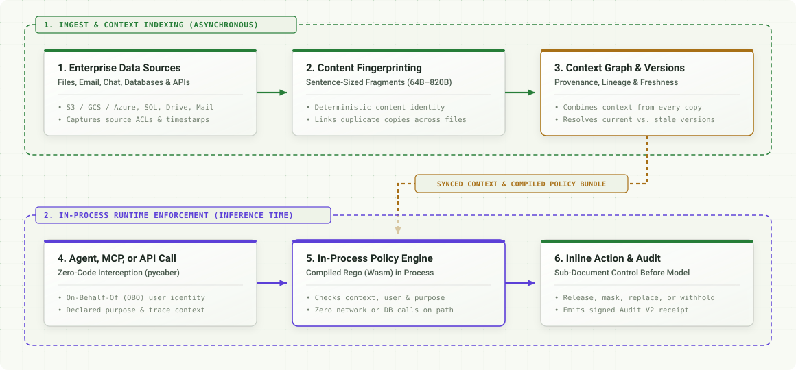

<p align="center">
  <a href="https://caber.com">
    
  </a>
</p>

<h1 align="center">Active Data Use Control for Agentic AI</h1>
<p align="center"><i>Freshness, provenance, and policy, checked down to the sentence before agents see it.</i></p>

<p align="center">
  <a href="https://caber.com">Website</a> ·
  <a href="https://caber.com/blogs">Blog</a> ·
  <a href="https://caber.com/request_briefing">Talk to Us</a>
</p>

---

Caber provides active, inline data use control, sub document mutation, and fragment level provenance for Generative AI, Retrieval Augmented Generation (RAG), and autonomous agentic workflows.

<table>
<tr>
<td width="25%" valign="top">

### 🔄 Freshness

Link every copy of a fragment across your systems, rebuild its version history from those copies, and withhold superseded versions.

</td>
<td width="25%" valign="top">

### 🎯 Provenance

Assign deterministic identity to data fragments as small as 64 bytes, about a sentence on average, and trace every copy to its source object and byte span.

</td>
<td width="25%" valign="top">

### ⚡ Data Use Policy

Evaluate compiled Rego policies in process to release, mask, replace, or withhold fragments before they reach an agent or model.

</td>
<td width="25%" valign="top">

### 🤖 Agent Native

Capture agent framework, MCP, and API calls without code changes, carrying the end user's on behalf of identity across every hop.

</td>
</tr>
</table>

---

## 🔍 Why Controlling AI Data Use Is Hard

Three facts about enterprise data explain why file level permissions and prompt only scanners fall short.

<details>
<summary><b>1. Enterprise data is duplicated, mostly inside documents</b></summary>
<br>
People copy the same paragraphs, tables, and boilerplate into files that otherwise differ, so controls that track whole files miss most of the copies. Backup and enterprise storage deduplication numbers <a href="https://community.ibm.com/community/user/blogs/puneet-sharma/2026/04/07/how-deduplication-works-in-ibm-storage-protect">often exceed 80 to 90 percent</a>, and reach <a href="https://www.silver-peak.com/sites/default/files/infoctr/panasoniccasestudy.pdf">up to 99 percent</a> for data in use on networks.
</details>

<details>
<summary><b>2. Most business data does not identify itself</b></summary>
<br>
Some data identifies itself: a payment card number has a fixed format and a check digit, so a pattern match finds it in any file. Most business data carries no such marker. Take a sentence from a board memo. Whether it is <b>fresh</b> (the current version), <b>stale</b> (because a newer document replaced it), or a <b>trade secret</b> (valuable because its owner keeps it secret) depends on facts outside the sentence. A classifier that reads only the text cannot tell these cases apart.
</details>

<details>
<summary><b>3. Content is finite; context is unbounded</b></summary>
<br>
A sentence is a fixed, finite string of bytes, but the context that governs how it may be used keeps growing with every new copy, reader, version, and policy: where each copy came from, who owns it, who may read it, which version is current, and which policies apply. Content copies freely, while context stays behind. A sentence pasted into an email loses the permissions of the folder it came from. Because the same sentence means different things in different places, handing raw text to an agent strips the rules that control its use.
</details>

---

## 🔧 How Caber Works

Caber solves these three problems by identifying content down to the sentence, gathering context from every copy across your systems, and enforcing policy in process at inference time.

1. **Fingerprint content.** Split each file, message, or API payload into fragments of about one sentence, and give each fragment a deterministic fingerprint. The same text gets the same fingerprint wherever it appears.
2. **Link the copies.** Group fragments with the same fingerprint across sources, formats, and systems so partial copies inside different documents share one identity.
3. **Collect context from every copy.** Attach each copy's source, owner, permissions, and timestamps, along with extracted entities and ontology labels, to the fragment in a context graph.
4. **Resolve versions** *(beta)*. Arrange related documents into a version history built from their shared fragments so policies can identify superseded content.
5. **Decide at inference time.** When an agent or application retrieves data, run compiled Rego policies in process against the fragment's context, the end user the agent acts for, and the purpose of the request to release, mask, replace, or withhold the fragment.
6. **Record the decision.** Emit an audit receipt that records the fragment, the policy, the identity, and the declared purpose.

<p align="center">
  <picture>
    <source media="(prefers-color-scheme: dark)" srcset="https://raw.githubusercontent.com/Caber-Systems/.github/main/profile/dual-plane-architecture-dark.svg">
    <source media="(prefers-color-scheme: light)" srcset="https://raw.githubusercontent.com/Caber-Systems/.github/main/profile/dual-plane-architecture-light.svg">
    
  </picture>
</p>

---

## ✨ What Sets Caber Apart

| | Capability | Detail |
|---|---|---|
| 🧬 | **Sentence Level Provenance** | Links each data fragment (down to 64 bytes, about a sentence) to every stored copy, its source object, and its exact byte span. |
| 🕰️ | **Multi Version Freshness Arbitration** *(beta)* | Rebuilds version history from overlapping copies and withholds superseded revisions at decision time (88% freshest version accuracy; 0.974 Kendall tau on a git history benchmark). |
| 🔁 | **Duplicates as Signal** | Groups identical fragments across email, chat, shared drives, and databases into equivalence classes with percent overlap scoring to surface where duplicated content lives. |
| 🛡️ | **Inline Rego Policies** | Compiles RBAC, ABAC, tenant, and purpose rules to WebAssembly for in process evaluation with no network or database call on the decision path. Hot reloadable and fail closed by default. |
| 👤 | **On Behalf Of (OBO) User Identity** | Decodes JWT, AWS SigV4, SPIFFE, and mTLS credentials and propagates the end user's identity across agent, MCP tool, and API hops via W3C trace context so policy evaluates the human behind the call. |

---

## ⚙️ Zero Code Integration

Taking inspiration from [OpenTelemetry](https://opentelemetry.io/) for zero code integration, Caber instruments existing Python applications without code changes. Set the connection to your Caber deployment, then run your application under `caber-run`:

```bash
export CSI_API_KEY="your-api-key"
export CSI_CABER_HOST="https://your-caber-instance.example.com"

caber-run python app.py
caber-run uvicorn myapp:app --host 0.0.0.0
```

Or enable it in code, before any HTTP or agent framework library is imported:

```python
import pycaber.auto  # must come before HTTP and agent framework imports

import requests
from langgraph.prebuilt import create_react_agent
# Tool calls, retrievals, and API responses are now captured and checked against policy
```

`pycaber` patches 15 transports, including requests, httpx, aiohttp, and urllib3; WSGI and ASGI servers; WebSocket clients; and gRPC clients and servers. It captures tool, retriever, and memory calls in LangChain, LangGraph, CrewAI, LlamaIndex, and AutoGen without changes to agent logic. For custom functions exposed to agents, the `@pycaber.tool` decorator attaches policy metadata. Policies are authored centrally in the Caber admin console and deployed into `caber-core`, not into application code.

---

## 📊 Performance & Sizing

| Property | Value | Status |
| :--- | :--- | :--- |
| **Fragment Granularity** | 64 byte minimum, about 187 bytes typical, about 820 byte maximum | Implemented (content defined fragmentation) |
| **Policy Evaluation Path** | Compiled Wasm in process; no network or database call | Implemented |
| **Policy Evaluation Latency** | P95 under 2.5 ms | Design target |
| **Mediated Retrieval Latency** | Under 35 ms | Design target |
| **Freshest Version Accuracy** | 88% freshest match; Kendall tau 0.974 | Measured on a git history benchmark *(beta)* |

Design targets are engineering goals, not measured results.

---

## 🔌 Ecosystem Integrations

Caber connects across your existing AI and infrastructure stacks:

| Agent Frameworks | Models & Vector Stores | Protocols & Identity | Data Sources (Connectors) |
| :--- | :--- | :--- | :--- |
| • **LangGraph**<br/>• **LangChain**<br/>• **LlamaIndex**<br/>• **CrewAI**<br/>• **AutoGen** | Calls detected and typed *(beta)*:<br/>• **OpenAI**, **Anthropic**<br/>• **AWS Bedrock**<br/>• **Google** (incl. Vertex AI)<br/>• **Cohere**, **Mistral**<br/>• **Groq**, **Together**, **Fireworks**, **DeepSeek**, **Perplexity**<br/>• **Self hosted endpoints** (e.g., vLLM, by configuration)<br/>• **Pinecone\***, **Weaviate\***, **Chroma\*** | • **Model Context Protocol** (MCP)<br/>• **A2A** *(beta)*<br/>• **gRPC / protobuf**, **WebSocket**<br/>• **OIDC / JWT** identity providers<br/>• **AWS SigV4**, **SPIFFE**, **mTLS** | • **AWS S3 / MinIO**<br/>• **Google Cloud Storage\***<br/>• **Azure Blob\***<br/>• **PostgreSQL**, **MySQL**, **SQLite**<br/>• **File systems**<br/>• **CloudTrail**, **Kafka\***, **API polling** |

\* On near term roadmap.

Caber is self hosted with Docker Compose, including a single host trial mode. Internally, `caber-core` uses RocksDB with Roaring bitmaps for the fingerprint index, OpenSearch for events and content, and Neo4j for the context graph.

---

## 🤝 Building With Enterprise Engineering Teams

Caber integrates with existing data pipelines, RAG systems, MCP servers, and agent workflows. It starts producing results from live traffic without requiring a prerequisite data inventory or catalog project. Policy evaluation runs inline at inference time.

We are building this with early design partners. If your team is building or operating AI systems and you want deterministic control over what data reaches your models, we would value your perspective.

<p align="center">
<a href="https://caber.com"><b>🌐 caber.com</b></a>&nbsp;&nbsp;&nbsp;·&nbsp;&nbsp;&nbsp;
<a href="https://caber.com/request_briefing"><b>💬 Start a Conversation</b></a>&nbsp;&nbsp;&nbsp;·&nbsp;&nbsp;&nbsp;
<a href="https://caber.com/blogs"><b>📝 Blog</b></a>
</p>

---

<p align="center"><sub>Copyright 2026, Caber Systems, Inc.</sub></p>
